Live Portfolio at: https://jenisitportfolio.wordpress.com/

Project Documentation: This repository contains the technical documentation, implementation steps, screenshots, and troubleshooting notes for deploying WordPress on Ubuntu Server using VMware Workstation.

WordPress Deployment on Ubuntu Server Using VMware Workstation

Project Overview

This project documents the deployment of WordPress on an Ubuntu Server virtual machine using VMware Workstation. It demonstrates practical experience with Linux server administration, web server configuration, database setup, PHP installation, and WordPress deployment.

Lab Environment:
-Host OS: Windows 11
-Virtualization: VMware Workstation
-Server OS: Ubuntu Server
-Web Server: Apache
-Database: MariaDB
-Application Requirements: PHP
-CMS: WordPress

Implementation Steps:

1. Virtual Machine Setup

Created an Ubuntu Server virtual machine in VMware Workstation and configured its virtual hardware and networking.

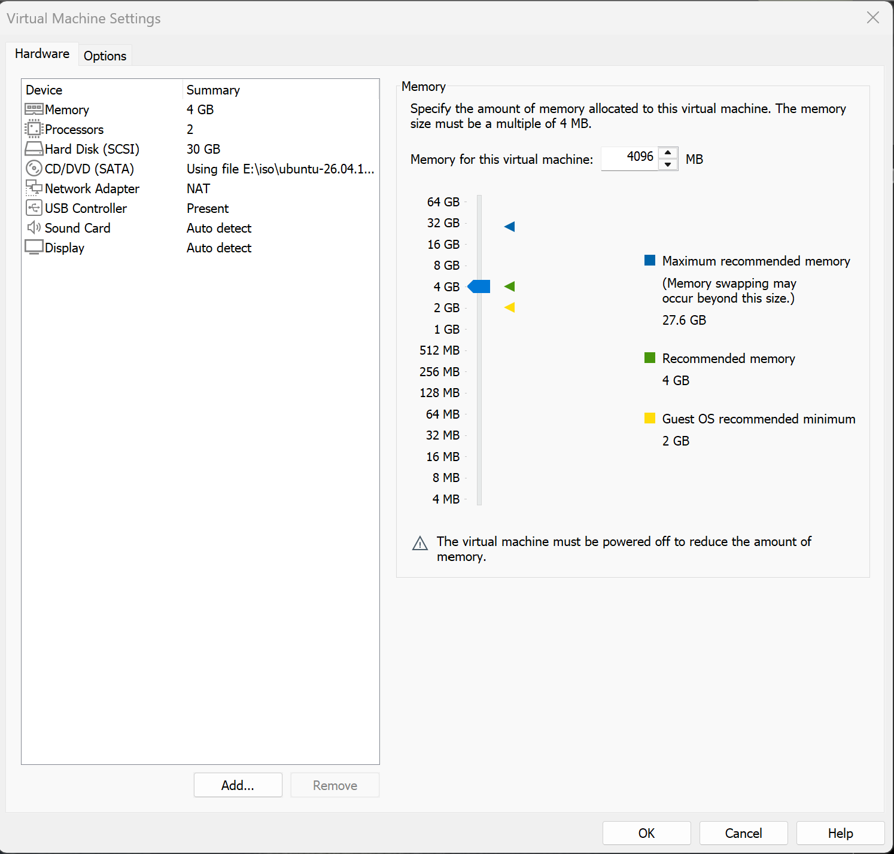

2. Ubuntu Server Installation

Installed Ubuntu Server and verified that the virtual machine booted successfully.

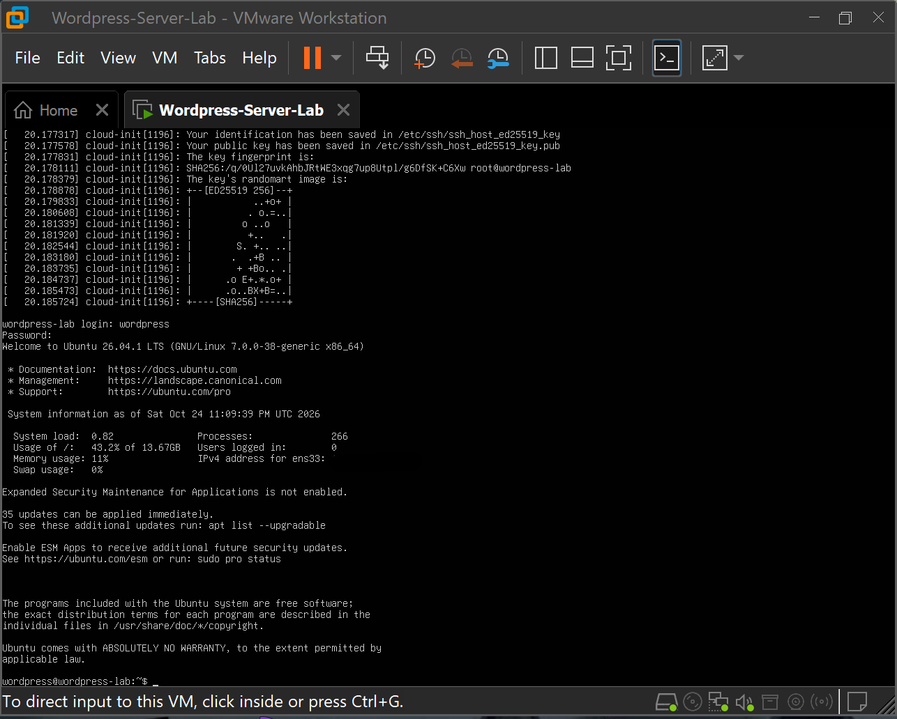

3. Apache Installation

Installed Apache to provide the web server for the WordPress site.

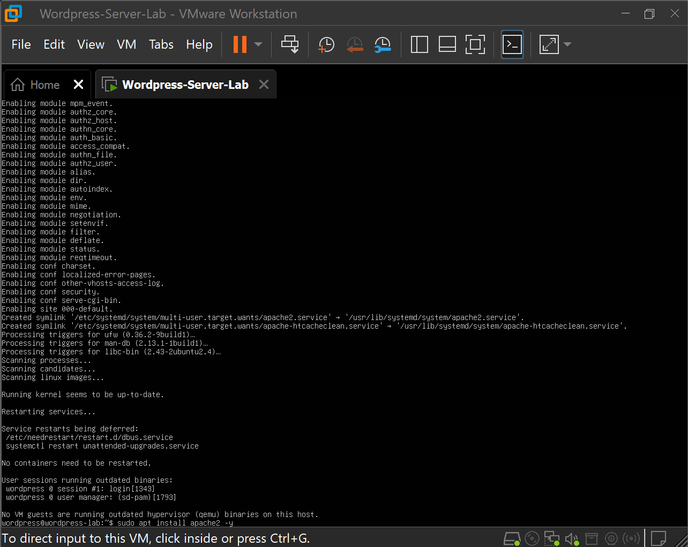

4. PHP Installation

Installed PHP and the required components to support WordPress.

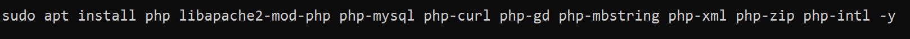

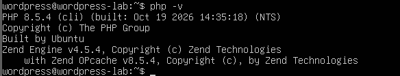

5. MariaDB Installation

Installed MariaDB to provide the database service required by WordPress.

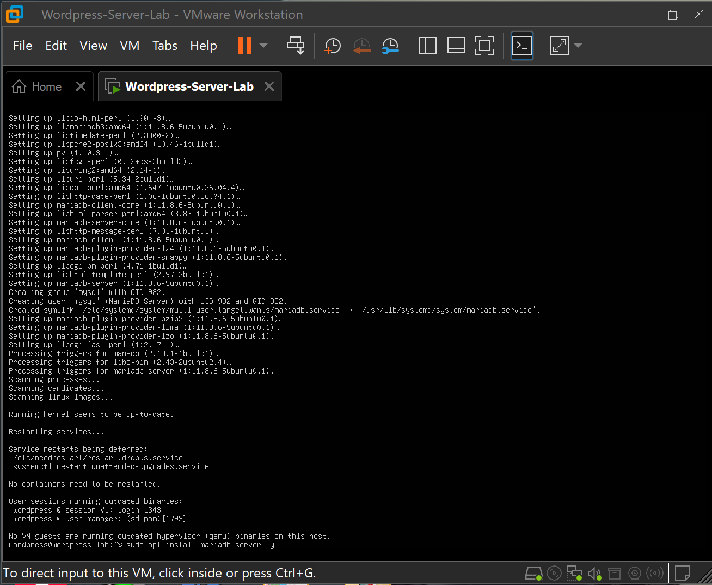

6. WordPress Setup

Configured WordPress and accessed the WordPress installation page through a web browser.

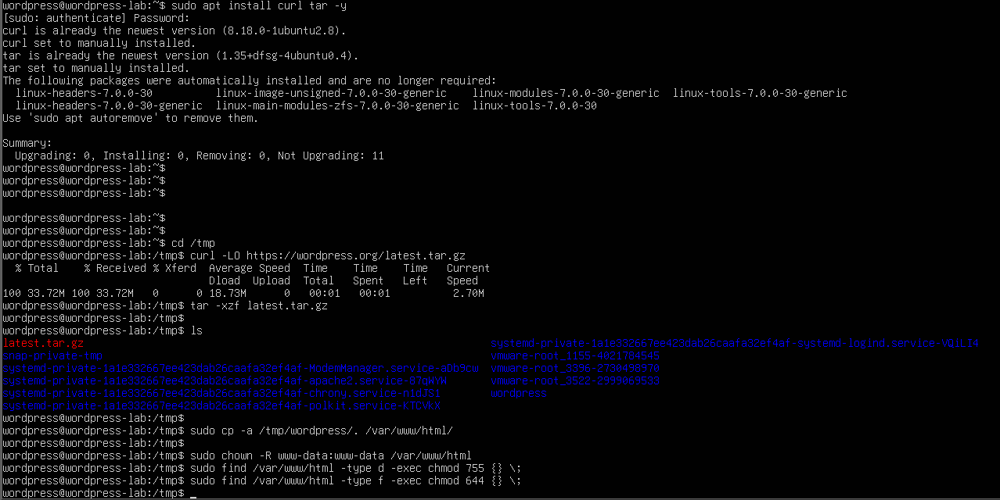

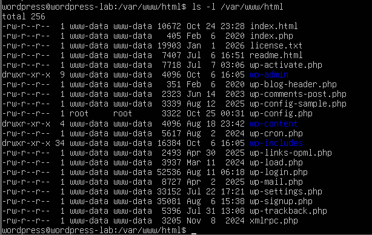

7. Troubleshooting

Initially, the Apache default page appeared instead of the WordPress setup page. I investigated the issue and renamed the default index.html file so WordPress could load as the website's main page.

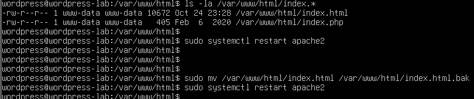

8. Verification

Completed the WordPress installation, accessed the dashboard, and published a technical blog post to verify that the website was working.

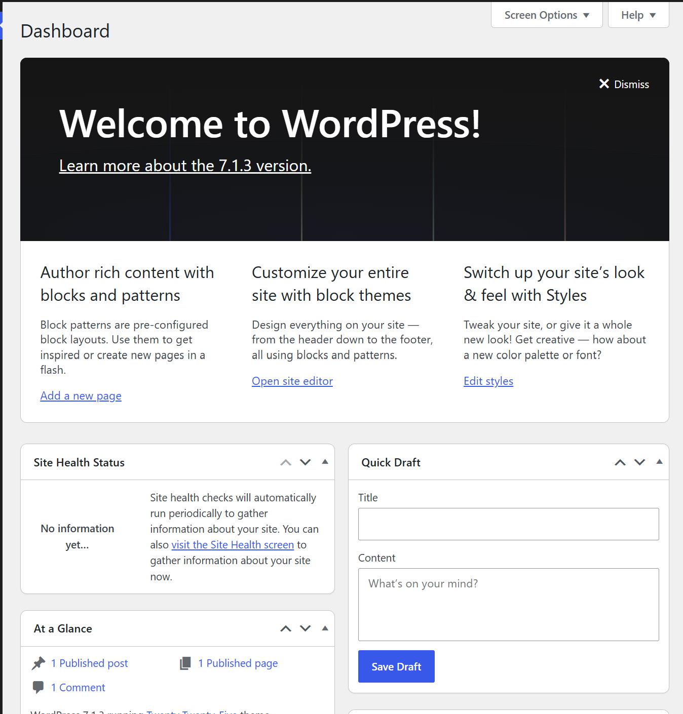 

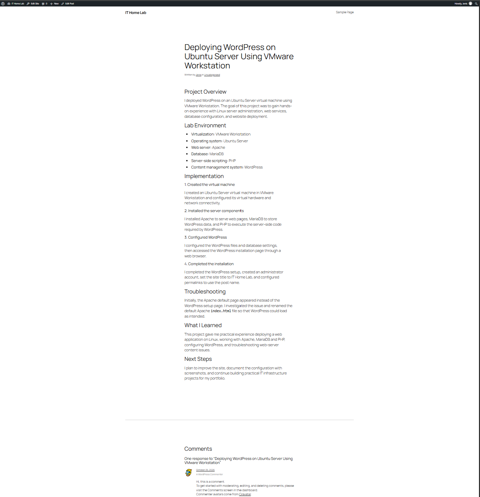 

Skills Demonstrated:
-Linux server administration
-Virtual machine deployment and configuration
-Apache web server installation
-PHP installation and verification
-MariaDB database setup
-WordPress deployment
-Troubleshooting and technical documentation

Outcome

Successfully deployed a working WordPress website on an Ubuntu Server virtual machine and documented the implementation process.

Notes

This project runs in a local lab environment. The website is not publicly accessible over the internet unless additional hosting and networking configuration is implemented.
